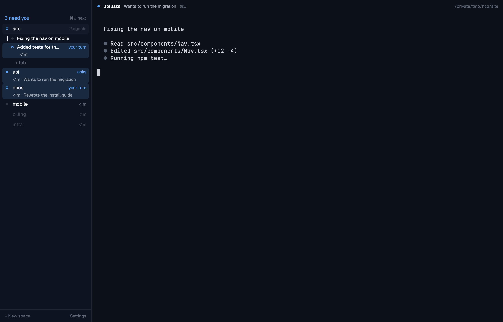
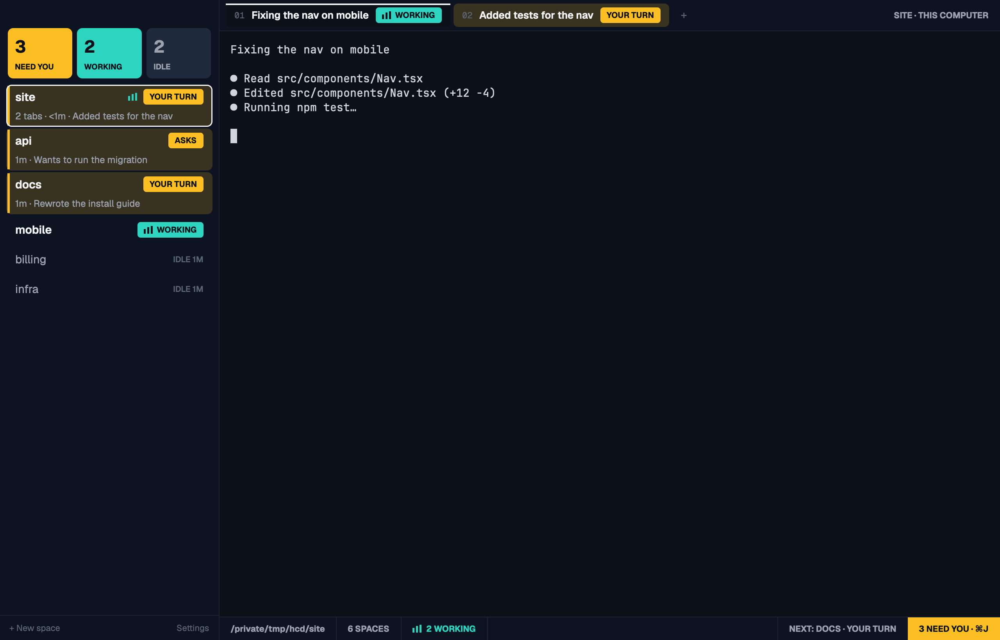

# herdr-layouts

My layouts for [Herdr](https://herdr.dev), the desktop app for running coding agents. I usually have around nine Claude Code agents going across two machines. When I glance at the window I want to know one thing: which agent needs me? The stock sidebar answers that, but slowly. It lists every space twice, puts the same icon on every agent, and hides "needs you" in a small dot on the far right.

These layouts are my answer to that. The repo is public so I can install them on whatever machine I sit down at.

## Layouts

| Layout | What it is |
|---|---|
| [Index](index/RECIPE.md) | One quiet list of spaces, grouped by machine. The only color on screen means "this agent needs you": it asked you something, or it finished and is waiting for your reply. ⌘J jumps to it. |
| [Signal](signal/RECIPE.md) | The same list, loud. Every row says its status in a filled block, three counters say how many agents need you, are working and are idle, and a numbered tab bar and a status bar frame the terminal. Amber means waiting on you; teal means working. |





## Install

You'll need Herdr installed and opened once, so it has written its settings. Then:

```sh
git clone https://github.com/amr05008/herdr-layouts.git
cd herdr-layouts
./install.sh index
herdr-app do layout.switch '{"name":"index"}'
```

The installer:

- copies only files named after the layout (`layouts/index.*`, `mods/index/`, `themes/index-*`);
- adds the layout's keys to your `keys.json`, asking before it takes a key you already use (your old file is kept as `keys.json.bak-<time>`);
- checks the mod with `herdr-app check`.

Run it again to update. `./install.sh` with no argument lists the layouts.

Signal installs the same way, with `signal` in place of `index`. It brings bold weights of Herdr's UI font, which Herdr loads when it starts, so restart Herdr once after installing it. The two layouts share one record of who is waiting on you, so you can switch between them freely.

To go back to Herdr's own layout, run `herdr-app do layout.switch '{"name":"main"}'`. ⌘⇧L cycles through your layouts.

## Keys

Index and Signal bind the same four keys, each only while that layout is showing.

| Key | What it does |
|---|---|
| ⌘J | Jump to the next agent that needs you |
| ⇧⌘J | Clear "your turn" on the agent you're on, when it needs no reply |
| ⇧⌘E | Show or hide Files |
| ⇧⌘G | Show or hide Changes |

## How it's built

Each layout is a folder in Herdr's gallery format: `layouts/`, `mods/`, a `RECIPE.md` that another agent could rebuild it from, and a `preview.png`. Both also have `themes/` and `keys.json`. Signal's mod carries copies of Index's `model.js` and `turns.js` (Herdr doesn't let a mod import from another's folder); a test keeps them identical. `plans/` holds the design docs.

To run the tests, use `npm test`. They run with Node and Python, with nothing to install.

## Credits

- [eiwe/herdr-layouts](https://github.com/eiwe/herdr-layouts), a friend's set of themed layouts (bridge, bunker, romulus), showed me the format.
- Parts of `index/mods/index` are adapted from the mods that ship with Herdr, which are Apache-2.0:
  - the age and title helpers in `model.js` (from `agents`)
  - drag-to-reorder in `sidebar.js` (from `spaces`)
  - the traffic-light padding and the panel toggle in `strip.js` (from `tabs`)
- `signal/mods/signal` shares those, and its `tabs.js` adapts tab clicks, the tab menu and drag-to-move from Herdr's `tabs`.
- Signal bundles Geist SemiBold and Bold from [vercel/geist-font](https://github.com/vercel/geist-font), under the SIL Open Font License (`signal/mods/signal/fonts/LICENSE-Geist.txt`).
