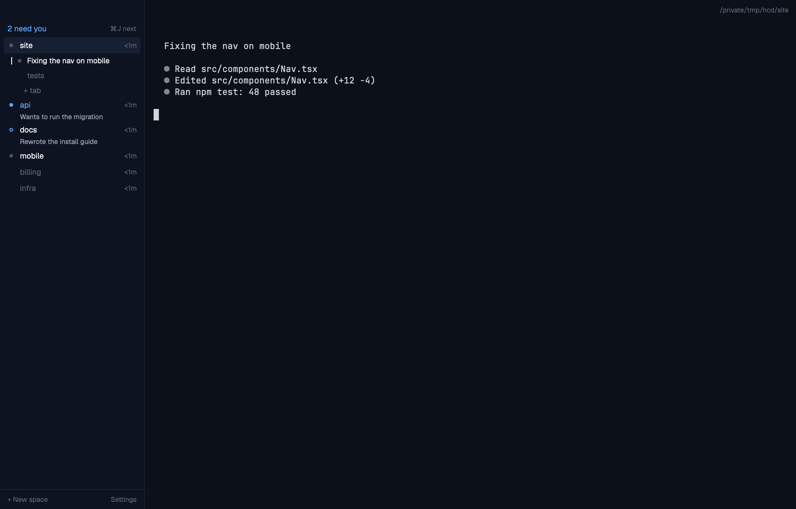

# herdr-layouts

My layouts for [Herdr](https://herdr.dev), the desktop app for running coding agents. I usually have around nine Claude Code agents going across two machines. When I glance at the window I want to know one thing: which agent needs me? The stock sidebar answers that, but slowly. It lists every space twice, puts the same icon on every agent, and hides "needs you" in a small dot on the far right.

These layouts are my answer to that. The repo is public so I can install them on whatever machine I sit down at.

## Layouts

| Layout | What it is |
|---|---|
| [Index](index/RECIPE.md) | One quiet list of spaces, grouped by machine. The only color on screen means "this agent needs you", and ⌘J jumps to it. |



## Install

You'll need Herdr installed and opened once, so it has written its settings. Then:

```sh
git clone <this repo>
cd herdr-layouts
./install.sh index
herdr-app do layout.switch '{"name":"index"}'
```

The installer:

- copies only files named after the layout (`layouts/index.*`, `mods/index/`, `themes/index-*`);
- adds the layout's keys to your `keys.json`, asking before it takes a key you already use (your old file is kept as `keys.json.bak-<time>`);
- checks the mod with `herdr-app check`.

Run it again to update. `./install.sh` with no argument lists the layouts.

To go back to Herdr's own layout, run `herdr-app do layout.switch '{"name":"main"}'`. ⌘⇧L cycles through your layouts.

## Index keys

These only apply while Index is showing.

| Key | What it does |
|---|---|
| ⌘J | Jump to the next agent that needs you |
| ⇧⌘E | Show or hide Files |
| ⇧⌘G | Show or hide Changes |

## How it's built

Each layout is a folder in Herdr's gallery format: `layouts/`, `mods/`, a `RECIPE.md` that another agent could rebuild it from, and a `preview.png`. Index also has `themes/` and `keys.json`. `plans/` holds the design docs.

To run the tests, use `npm test`. They run with Node and Python, with nothing to install.

## Credits

- [eiwe/herdr-layouts](https://github.com/eiwe/herdr-layouts), a friend's set of themed layouts (bridge, bunker, romulus), showed me the format.
- Parts of `index/mods/index` are adapted from the mods that ship with Herdr, which are Apache-2.0:
  - the age and title helpers in `model.js` (from `agents`)
  - drag-to-reorder in `sidebar.js` (from `spaces`)
  - the traffic-light padding and the panel toggle in `strip.js` (from `tabs`)
