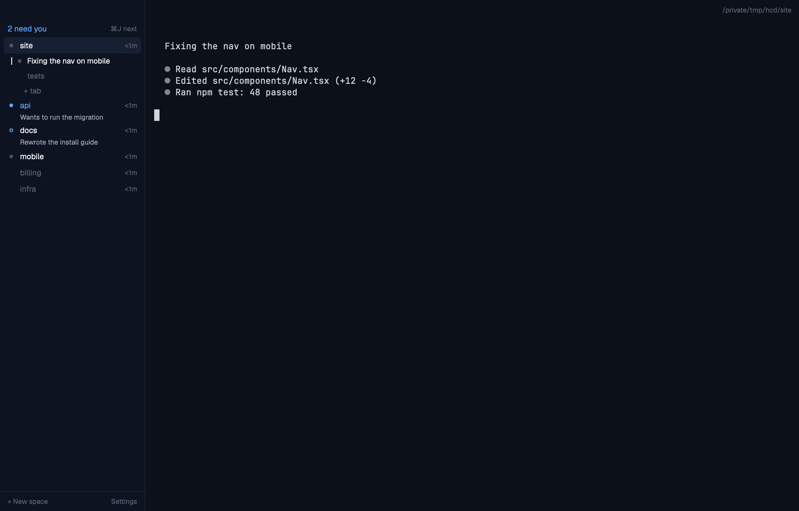

# Index

A quiet Herdr window built around one question: which agent needs me? The left side is one list of your spaces, grouped by machine, in Herdr's own order. Rows never move on their own. Nothing on screen is colored except the agents that need you: a blue dot means one is waiting on you, a blue ring means one finished while you weren't looking. ⌘J jumps to the next one. Everything else (tab bar, status bar, icons, letter tiles, pane cards) is gone.

## What you see

The window has no system title bar. It is one row: the sidebar (232 px, min 44, max 480), a 1 px `#1c2433` line, then the work area. macOS draws its traffic lights at `[14, 10]` over the sidebar's top.

**Sidebar** (`#0d1320`), top to bottom:

1. **Top strip, 32 px.** Empty. You drag the window by it, and the traffic lights sit in it.
2. **Needs-you line, 28 px.** On the left, "2 need you" in the accent color, 12.5 px Geist, semibold. On the right, the key that jumps there, read from your `keys.json` ("⌘J next", 11 px, faint). With nothing to do, the line is empty but keeps its height.
3. **Machine groups**, in Herdr's order (this computer first). Labels are 11 px and faint: "This computer", then each machine's name. An unreachable machine reads "name · offline" and its rows are dimmed to 50%. With only one machine there are no labels.
4. **Space rows**, 26 px tall (40 px with a detail line):
   - a 12 px status-mark column, then the name at 12.5 px;
   - on the right, a 56 px slot (11 px, faint) with the age (`<1m`, `5m`, `1h`, `2d`), or "2 agents" when the space has two or more;
   - the current space has a `#172033` background, radius 5; other rows get `#121a29` on hover;
   - a **detail line** (11 px, `#9ca3af`, truncated) shows the agent's terminal title, only when the space is blocked or done. It is skipped when the title is a path, a `user@host`, or just the program's name.
5. **The current space expands.**
   - Tab rows (24 px, 12 px text, faint) sit under it. The shown tab is in full text, with a 1.5 × 12 px tick at its left.
   - A tab split between two or more agents lists them one indent deeper, by program (`claude`, `codex`).
   - A faint "+ tab" row comes last.
6. **Blocked sub-agents** (terminals an agent started with `hc run`) appear as an indented row under their space while they're blocked, with their own detail line.
7. **Footer, 32 px**, with a hairline above: "+ New space" on the left and "Settings" on the right, both 11 px and faint.

**Work area:**

- **Top strip, 32 px** (`#0b1019`, you can drag the window by it): the focused terminal's folder and git branch, right-aligned, 11 px, faint ("~/repos/site · main").
- **The shown tab** fills the rest.
  - A single pane is a bare terminal, with no frame and no label.
  - Split panes are separated by 1 px `#1c2433` lines. Each pane gets a 22 px label: the program name (full text on the focused pane, faint on the others), then its folder, faint.
- There is no tab bar and no status bar. Files and Changes live in a hidden 368 px panel on the right.

**Colors** (themes `index-dark` and `index-light`; the layout follows Herdr's appearance setting):

| Role | Dark | Light |
|---|---|---|
| Window and terminal background | `#0b1019` | `#ffffff` |
| Sidebar | `#0d1320` | `#f9fafb` |
| Hairlines | `#1c2433` | `#e5e7eb` |
| Primary text | `#f3f4f6` | `#111827` |
| Secondary text (detail lines) | `#9ca3af` | `#4b5563` |
| Faint text (labels, ages) | `#5b6475` | `#9ca3af` |
| Current row | `#172033` | `#f3f4f6` |
| Accent ("needs you") | `#60a5fa` | `#2563eb` |
| Terminal text | `#d1d5db` | `#1f2937` |

The UI font is Geist (it ships with Herdr). The terminal font is whatever your settings say.

## How it behaves

**Agent statuses** (the whole visual language):

| Status | Mark | Name |
|---|---|---|
| blocked (waiting on you) | 6 px filled accent dot | accent, semibold, plus a detail line |
| done (finished, not seen yet) | 6 px accent ring, 1.5 px | full text, semibold, plus a detail line |
| working | 6 px `#9ca3af` dot, opacity pulsing 0.25 ↔ 1 every 1.4 s | full text |
| idle, or no agent | nothing | faint |

- A space shows its most urgent agent. A blocked sub-agent lifts its parent's space to blocked.
- "N need you" counts the blocked agents, the blocked sub-agents and the done agents.
- Looking at a done agent makes it idle: the ring goes and the count drops.
- **⌘J** jumps to the next one:
  - blocked agents first (each followed by its blocked sub-agents), then done ones, in list order, wrapping around;
  - a sub-agent without a pane opens in a peek window;
  - after a done agent you've just looked at, it carries on with the one after it;
  - it works with the sidebar hidden, and clicking the needs-you line does the same.
- **⇧⌘E** opens the right panel on Files and **⇧⌘G** on Changes. Pressing the same key again closes it.
- **Space row:**
  - click: show the space
  - drag: reorder it within its machine (an accent line marks where it lands)
  - double-click: rename
  - right-click: Herdr's space menu
- **Tab row:** click shows the tab, double-click renames it, right-click opens Herdr's tab menu.
- **Agent or sub-agent row:** click focuses it, or opens a peek when it has no pane.
- **"+ tab", "+ New space" and "Settings"** run `tab.new`, `space.new` and `app.settings`.
- **Ages** are the time since that agent last changed state, with done and idle counting as one. They refresh every 30 s.
- **Under 160 px wide** (drag the sidebar's edge narrower), it becomes a rail:
  - the count at the top;
  - one mark per space (an idle space gets a faint 4 px dot so there's something to click), with a hairline between machines;
  - the current space highlighted;
  - clicking a mark shows that space.
- **⌘B** hides the sidebar. The work-area strip then keeps clear of the traffic lights.
- **⌘]** and **⌘[** (Herdr's own `agent.next` and `agent.prev`) follow the list order.

## Built from

- **`layouts/index.json`:**
  - root `row`, with `titlebar: none`, `traffic_lights: [14, 10]`, `theme: {dark: index-dark, light: index-light}`, `ui_font: Geist`, `terminal_padding: [14, 12]` and a `border` divider;
  - `sidebar` column (232 px, `resizable: false` inside):
    - `sidebar-top`: a 32 px block, `window_drag`
    - `sidebar-list`
  - `work` column:
    - `strip`: a 32 px block, `window_drag`
    - `work-body` row:
      - `main`: tab block, background `border`. Panes have gap 1, radius 0, background `background`, `lone: false`, and a 22 px top header.
      - `panel`: column, hidden, 368 px. It holds the `panel-body` stack, with the shipped `files` and `changes` mods.
- **`mods/index`:** one mod in four roles, chosen by props:
  - `{role: "top"}` draws nothing
  - `{role: "sidebar"}` is the list
  - `{role: "strip"}` is the work-area strip and owns the key commands
  - the pane header gets `{pane}` from Herdr and draws the pane label
  - `model.js` holds all the decisions as pure functions (grouping, statuses, ⌘J order, key labels), tested with Node.
- **`herdr` functions:** `spaces`, `agents`, `terminals`, `machines`, `panes`, `focused`, `keys`, `layout`, `window`, `settings`, `theme`, `home`, `props`, `run`, `openOverlay` (for the shipped `menu`), `setAgentOrder`, `nextCommand`.
- **Commands:** `space.select`, `space.move`, `space.rename`, `space.new`, `tab.select`, `tab.rename`, `tab.new`, `agent.focus`, `terminal.peek`, `layout.select`, `layout.show`, `layout.hide`, `app.settings`.
- **`themes/index-dark.json` and `themes/index-light.json`:** terminal colors plus panel color overrides (`chrome`, `canvas`, `border`, `foreground`, `muted`, `dim`, `selected`, `hover`, `accent`, `blocked`, `done`, `working`, `idle`).
- **`keys.json`:** a `layout:index` section binding `cmd-j` → `index.next-needs-you`, `cmd-shift-e` → `index.files`, `cmd-shift-g` → `index.changes`.
- No network access, no programs run, no files read.

## Watch out

- **Herdr refuses imports from outside a mod's folder.** That's why the sidebar, the strip and the pane label are one mod with roles: ⌘J has to use exactly the sidebar's logic.
- **`init(props, cx)` doesn't receive the block's props** in Herdr 0.1.14. Read `props()` instead, or every copy draws the default role.
- **Set `resizable: false` on the sidebar column.** Otherwise the boundary between the top strip and the list can be dragged, and Herdr remembers it.
- **Herdr's gallery install copies only `layouts/` and `mods/`**, not `themes/`. Use `./install.sh index`, which copies the themes and merges the keys.
- **Keys live in a `layout:index` section**, so they only apply while Index shows. A key bound in your `terminal` section wins over them. The installer says so and skips it.
- **"done" only shows after "working".** An agent that reports `done` straight away reads as idle.
- **`agent.focus` doesn't move focus to a sub-agent that has no pane.** That's why ⌘J peeks at those.
- **Ages start at `<1m`** on a fresh install, because Index begins tracking when it first runs.
- **`herdr-app shot` only gets new frames while the window is visible.**
- **The themes set terminal text to `#d1d5db` and panel text (`colors.foreground`) to `#f3f4f6`.** This build didn't measure whether Herdr applies the panel value to terminal text as well.
- **To shoot a preview without your real spaces:**
  1. Start a separate core with `HC_SESSION=demo`.
  2. Add made-up spaces to it with `hc run --keep --label herdr.space=<name> …` (the space is named after its folder).
  3. Open a second window with `HC_SESSION=demo HERDR_APP_HOME=/tmp/<demo-home> herdr-app`. Set `"frame.welcomed": "finished"` in that home's `shared.json` first, or the welcome screen covers it.
  4. Shoot it with `HERDR_APP_HOME=… herdr-app shot`.
  5. Afterwards, stop the core with `HC_SESSION=demo hc server stop` and delete `~/.local/state/herdr-core/demo`.
- **"done" has to happen while the window is open.** An agent that is already done when the window opens reads as seen.
- **To test statuses without real agents,** use `tests/fake-agent.sh working,done "title"`. It prints Herdr's status report (`ESC ] 7501 ; state=… BEL`) and sets the title.

## Done when

- `npm test` passes (model, keys merge, installer).
- `herdr-app check` passes for `mods/index`. After `layout.switch {"name":"index"}`, `herdr-app status` shows no errors.
- Every space appears exactly once, grouped by machine, in Herdr's order. There are no icons and no letter tiles.
- A blocked agent shows a filled accent dot, an accent name and its title, and the count includes it. ⌘J focuses it, also with the sidebar hidden.
- A done agent shows a ring. After looking at it, the ring goes and the count drops.
- A blocked `hc run` sub-agent marks its parent's space, appears as a row, and is reachable by ⌘J.
- A working agent's row stays one line tall.
- ⇧⌘E and ⇧⌘G show and hide Files and Changes.
- The current space lists its tabs, and clicking one switches to it. There's no tab bar.
- A split tab shows a hairline between panes and a label on each; a single pane has no frame.
- With `appearance` set to `light`, the light palette shows.
