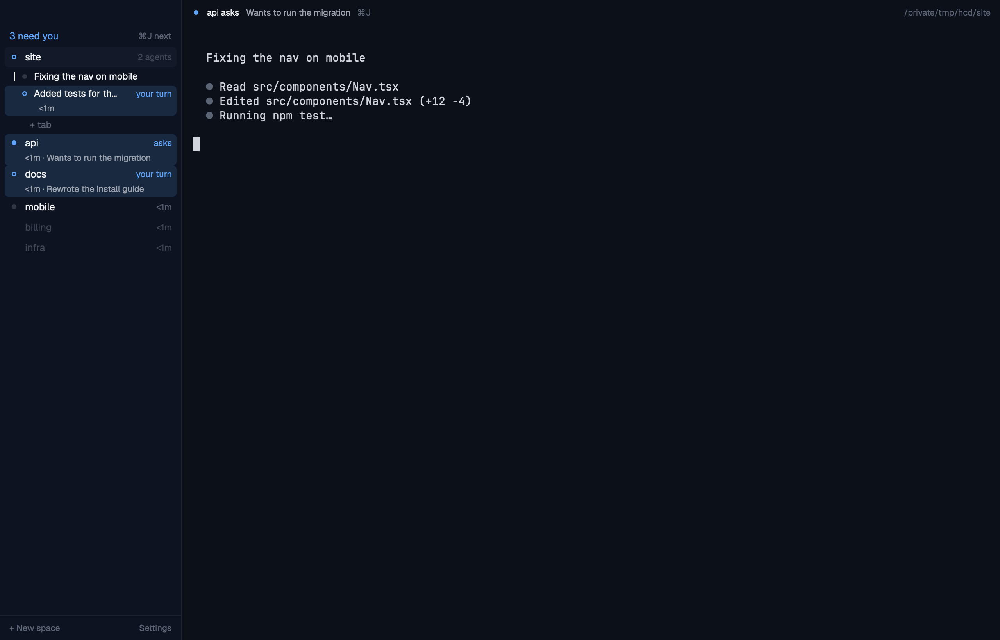

# Index

A quiet Herdr window built around one question: which agent needs me? The left side is one list of your spaces, grouped by machine, in Herdr's own order. Rows never move on their own. Nothing on screen is colored except the agents that need you. A row waiting on you is the only filled row in the list:
- a blue dot and "asks" mean the agent stopped to ask you something;
- a blue ring and "your turn" mean it finished and hasn't heard back from you. It stays that way until you reply or dismiss it (⇧⌘J); looking at it doesn't clear it.

⌘J jumps to the next one, and the strip above your terminal names it. Everything else (tab bar, status bar, icons, letter tiles, pane cards) is gone.

## What you see

The window has no system title bar. It is one row: the sidebar (232 px, min 44, max 480), a 1 px `#1c2433` line, then the work area. macOS draws its traffic lights at `[14, 10]` over the sidebar's top.

**Sidebar** (`#0d1320`), top to bottom:

1. **Top strip, 32 px.** Empty. You drag the window by it, and the traffic lights sit in it.
2. **Needs-you line, 28 px.** On the left, "2 need you" in the accent color, 12.5 px Geist, semibold. On the right, the key that jumps there, read from your `keys.json` ("⌘J next", 11 px, faint). With nothing to do, the line is empty but keeps its height.
3. **Machine groups**, in Herdr's order (this computer first). Labels are 11 px and faint: "This computer", then each machine's name. An unreachable machine reads "name · offline" and its rows are dimmed to 50%. With only one machine there are no labels.
4. **Space rows**, 26 px tall (40 px with a detail line):
   - a 12 px status-mark column, then the name at 12.5 px;
   - on the right, a 56 px slot (11 px, faint) with the age (`<1m`, `5m`, `1h`, `2d`), or "2 agents" when the space has two or more;
   - a **lit row** (an agent of its own asks or has its turn) has the accent at 15% as its background (9% on light), radius 5. Its name is full text and semibold, and the right slot says "asks" or "your turn" in the accent, semibold, instead of the age;
   - a lit row's **detail line** (11 px, `#9ca3af`, truncated) reads "<age> · <title>": how long it has waited, then the agent's terminal title. The title is skipped when it's a path, a `user@host`, just the program's name, or already the row's name;
   - the current space has the hover color (`#121a29`) as its background, so any lit row outranks it. It's never lit itself: its tab rows carry its waiting agent. Other rows get `#121a29` on hover;
   - quiet spaces (nothing waiting, nothing working) draw their name and age one step fainter than the faint text: `dim` mixed 35% toward the sidebar (`#404857`).
5. **The current space expands.**
   - Tab rows (24 px, 12 px text, faint) sit under it. The shown tab is in full text, with a 1.5 × 12 px tick at its left.
   - A tab whose agent waits on you is lit like a space row, with the word on the right and its detail line.
   - A tab split between two or more agents lists them one indent deeper, by program (`claude`, `codex`). Then each agent row is lit on its own, and the tab row isn't.
   - A faint "+ tab" row comes last.
6. **Sub-agents that ask** (terminals an agent started with `hc run`, while blocked) appear as an indented lit row under their space, with their own detail line. The space row shows the mark but isn't lit, so nothing is lit twice.
7. **Footer, 32 px**, with a hairline above: "+ New space" on the left and "Settings" on the right, both 11 px and faint.

**Work area:**

- **Top strip, 32 px** (`#0b1019`, you can drag the window by it), 11 px:
  - on the left, the agent ⌘J would go to next: its mark, "<space> asks" or "<space> · your turn" (full text, semibold), its title (`#9ca3af`, truncated at 360 px) and the ⌘J label (faint). It's empty when nothing waits or that agent already has focus. Clicking it does what ⌘J does;
  - on the right, the focused terminal's folder and git branch, faint ("~/repos/site · main"). This is what truncates when space runs out.
- **The shown tab** fills the rest.
  - A single pane is a bare terminal, with no frame and no label.
  - Split panes are separated by 1 px `#1c2433` lines. Each pane gets a 22 px label: the program name (full text on the focused pane, faint on the others), then its folder, faint.
- There is no tab bar and no status bar. Files and Changes live in a hidden 368 px panel on the right.

**Colors** (themes `index-dark` and `index-light`; the layout follows Herdr's appearance setting):

| Role | Dark | Light |
|---|---|---|
| Window and terminal background | `#0b1019` | `#ffffff` |
| Sidebar | `#0d1320` | `#f9fafb` |
| Hairlines | `#1c2433` | `#e5e7eb` |
| Primary text | `#f3f4f6` | `#111827` |
| Secondary text (detail lines) | `#9ca3af` | `#4b5563` |
| Faint text (labels, ages) | `#5b6475` | `#9ca3af` |
| Current row | `#172033` | `#f3f4f6` |
| Accent ("needs you") | `#60a5fa` | `#2563eb` |
| Terminal text | `#d1d5db` | `#1f2937` |

The UI font is Geist (it ships with Herdr). The terminal font is whatever your settings say.

## How it behaves

**Agent statuses** (the whole visual language):

| Status | Comes from | Mark | Row |
|---|---|---|---|
| asks | Herdr's `blocked`, or a sub-agent that's blocked or errored | 6 px filled accent dot | lit, "asks" |
| your turn | the agent went from working to done or idle, and hasn't worked or been dismissed since | 6 px accent ring, 1.5 px | lit, "your turn" |
| working | Herdr's `working` | 6 px `#9ca3af` dot, opacity pulsing 0.25 ↔ 1 every 1.4 s | full text |
| quiet | anything else: dismissed, hasn't finished since Index first saw it, or no agent | nothing | fainter than faint |

- **What ends "your turn":** the agent works again (you replied), you press ⇧⌘J while it has focus, or it goes away. Looking at it, focusing it and ⌘J landing on it don't. There's no time limit.
- **An agent Index sees for the first time** starts quiet, unless Herdr reports it `done`, in which case it starts as your turn. A finish that happened while the window was closed still counts: Index remembers the agent was working.
- **Sub-agents never have a turn.** Their "done" is their parent's news. One that asks lifts its parent's space to asks.
- **⇧⌘J** clears "your turn" on the focused agent. It does nothing on an agent that asks (it's stuck until you answer) or on anything else. The agent's next finish lights it again.
- A space shows its most urgent agent: asks, then your turn, then working.
- "N need you" counts everything that asks or has its turn.
- **⌘J** jumps to the next one:
  - agents that ask first (each followed by its sub-agents that ask), then your-turn ones, in list order, wrapping around;
  - your turn stays lit when ⌘J lands on it, so the next press moves on;
  - a sub-agent without a pane opens in a peek window;
  - it works with the sidebar hidden, and clicking the needs-you line or the strip's next-up line does the same.
- **⇧⌘E** opens the right panel on Files and **⇧⌘G** on Changes. Pressing the same key again closes it.
- **Space row:**
  - click: show the space
  - drag: reorder it within its machine (an accent line marks where it lands)
  - double-click: rename
  - right-click: Herdr's space menu
- **Tab row:** click shows the tab, double-click renames it, right-click opens Herdr's tab menu.
- **Agent or sub-agent row:** click focuses it, or opens a peek when it has no pane.
- **"+ tab", "+ New space" and "Settings"** run `tab.new`, `space.new` and `app.settings`.
- **Ages** are the time since that agent last changed state, with done and idle counting as one. They refresh every 30 s.
- **Under 160 px wide** (drag the sidebar's edge narrower), it becomes a rail:
  - the count at the top;
  - one mark per space (a quiet space gets a faint 4 px dot so there's something to click), with a hairline between machines;
  - a space waiting on you gets the lit background;
  - the current space highlighted;
  - clicking a mark shows that space.
- **⌘B** hides the sidebar. The work-area strip then keeps clear of the traffic lights.
- **⌘]** and **⌘[** (Herdr's own `agent.next` and `agent.prev`) follow the list order.

## Built from

- **`layouts/index.json`:**
  - root `row`, with `titlebar: none`, `traffic_lights: [14, 10]`, `theme: {dark: index-dark, light: index-light}`, `ui_font: Geist`, `terminal_padding: [14, 12]` and a `border` divider;
  - `sidebar` column (232 px, `resizable: false` inside):
    - `sidebar-top`: a 32 px block, `window_drag`
    - `sidebar-list`
  - `work` column:
    - `strip`: a 32 px block, `window_drag`
    - `work-body` row:
      - `main`: tab block, background `border`. Panes have gap 1, radius 0, background `background`, `lone: false`, and a 22 px top header.
      - `panel`: column, hidden, 368 px. It holds the `panel-body` stack, with the shipped `files` and `changes` mods.
- **`mods/index`:** one mod in four roles, chosen by props:
  - `{role: "top"}` draws nothing
  - `{role: "sidebar"}` is the list
  - `{role: "strip"}` is the work-area strip and owns the key commands
  - the pane header gets `{pane}` from Herdr and draws the pane label
  - `model.js` holds all the decisions as pure functions (grouping, statuses and turns, what each row says, ⌘J order, key labels), tested with Node.
  - `colors.js` works out the lit background (the accent plus alpha `26` on dark, `17` on light) and the quiet color from the theme, also pure and tested.
  - `turns.js` keeps the stamps and turns in Herdr's shared store, `shared("index.turns")`. Every copy (sidebar and strip) reads the same record, and setting it redraws them all. It's set only when something changed.
- **`herdr` functions:** `spaces`, `agents`, `terminals`, `machines`, `panes`, `focused`, `keys`, `layout`, `window`, `settings`, `theme`, `home`, `props`, `run`, `openOverlay` (for the shipped `menu`), `setAgentOrder`, `nextCommand`, `shared`, `setShared`.
- **Commands:** `space.select`, `space.move`, `space.rename`, `space.new`, `tab.select`, `tab.rename`, `tab.new`, `agent.focus`, `terminal.peek`, `layout.select`, `layout.show`, `layout.hide`, `app.settings`.
- **`themes/index-dark.json` and `themes/index-light.json`:** terminal colors plus panel color overrides (`chrome`, `canvas`, `border`, `foreground`, `muted`, `dim`, `selected`, `hover`, `accent`, `blocked`, `done`, `working`, `idle`).
- **`keys.json`:** a `layout:index` section binding `cmd-j` → `index.next-needs-you`, `cmd-shift-j` → `index.dismiss`, `cmd-shift-e` → `index.files`, `cmd-shift-g` → `index.changes`.
- No network access, no programs run, no files read.

## Watch out

- **Herdr refuses imports from outside a mod's folder.** That's why the sidebar, the strip and the pane label are one mod with roles: ⌘J has to use exactly the sidebar's logic.
- **`init(props, cx)` doesn't receive the block's props** in Herdr 0.1.14. Read `props()` instead, or every copy draws the default role.
- **Set `resizable: false` on the sidebar column.** Otherwise the boundary between the top strip and the list can be dragged, and Herdr remembers it.
- **Herdr's gallery install copies only `layouts/` and `mods/`**, not `themes/`. Use `./install.sh index`, which copies the themes and merges the keys.
- **Keys live in a `layout:index` section**, so they only apply while Index shows. A key bound in your `terminal` section wins over them. The installer says so and skips it.
- **"done" only shows after "working".** An agent that reports `done` straight away reads as idle.
- **`agent.focus` doesn't move focus to a sub-agent that has no pane.** That's why ⌘J peeks at those.
- **Ages start at `<1m`** on a fresh install, because Index begins tracking when it first runs. Agents that are idle then start quiet: Index can't know whether they're waiting on you.
- **`localStorage` is per mod copy.** That's why turns live in `shared("index.turns")`: the strip's ⇧⌘J has to clear what the sidebar shows. Stamps from before turns existed move there once, from the sidebar's `localStorage`, and read as quiet.
- **`herdr-app shot` only gets new frames while the window is visible.**
- **The themes set terminal text to `#d1d5db` and panel text (`colors.foreground`) to `#f3f4f6`.** This build didn't measure whether Herdr applies the panel value to terminal text as well.
- **To shoot a preview without your real spaces:**
  1. Make a demo home: `mkdir /tmp/<demo-home>`, then write `{"frame.welcomed":"finished"}` to its `shared.json`, or the welcome screen covers the window. After a Herdr update, also set `"presented": ["<version>"]` in its `update-notes.json`, or the update notice covers the corner (`overlay.close` reports ok but doesn't clear it).
  2. Open the window with `HC_SESSION=demo HERDR_APP_HOME=/tmp/<demo-home> herdr-app`. Then run `HERDR_APP_HOME=… ./install.sh index`, switch to Index with `herdr-app do layout.switch`, and set `"appearance": "dark"` in that home's `settings.json`.
  3. Only now start the made-up agents with `HC_SESSION=demo hc run --bg --no-parent --label herdr.space=<name> --cwd /tmp/<folder>/<name> -- sh tests/fake-agent.sh …` (the space is named after its folder). Index has to see "working" turn into "done" for a row to read "your turn"; an agent that finished before the window opened reads as quiet.
  4. New spaces land in no particular order: put them in yours with `space.move {id, index}`. Then shoot with `HERDR_APP_HOME=… herdr-app shot`.
  5. Afterwards, run `HERDR_APP_HOME=… herdr-app do app.quit` and `HC_SESSION=demo hc server stop`, then delete `~/.local/state/herdr-core/demo` and the demo home.
- **A finish while the window is closed still lights,** because Index stored the agent as working. But a reply and a finish that both happen while it's closed (from another Herdr client) look like nothing changed, and Index keeps what it had. ⇧⌘J or the next finish puts it right.
- **The detail line is the terminal title** (for Claude Code, the session's name), not the agent's last message.
- **An agent someone else prompts** (a channel bot, a shared session) lights up after every turn it takes. ⇧⌘J clears it.
- **To test statuses without real agents,** use `tests/fake-agent.sh working,done "title"`. It prints Herdr's status report (`ESC ] 7501 ; state=… BEL`) and sets the title.

## Done when

- `npm test` passes (model, keys merge, installer).
- `herdr-app check` passes for `mods/index`. After `layout.switch {"name":"index"}`, `herdr-app status` shows no errors.
- Every space appears exactly once, grouped by machine, in Herdr's order. There are no icons and no letter tiles.
- An agent that asks shows a lit row with a filled dot, "asks" and "<age> · <title>", and the count includes it. ⌘J focuses it, also with the sidebar hidden, and ⇧⌘J doesn't clear it.
- An agent that finishes shows a lit row with a ring and "your turn". Looking at it doesn't clear it. Replying (it works again) or ⇧⌘J does, and the count drops at once in the sidebar and the strip.
- The strip names the next ⌘J target.
- The current-space highlight is quieter than any lit row.
- A blocked `hc run` sub-agent marks its parent's space, appears as a lit row, and is reachable by ⌘J.
- A working agent's row stays one line tall.
- ⇧⌘E and ⇧⌘G show and hide Files and Changes.
- The current space lists its tabs, and clicking one switches to it. There's no tab bar.
- A split tab shows a hairline between panes and a label on each; a single pane has no frame.
- With `appearance` set to `light`, the light palette shows.
