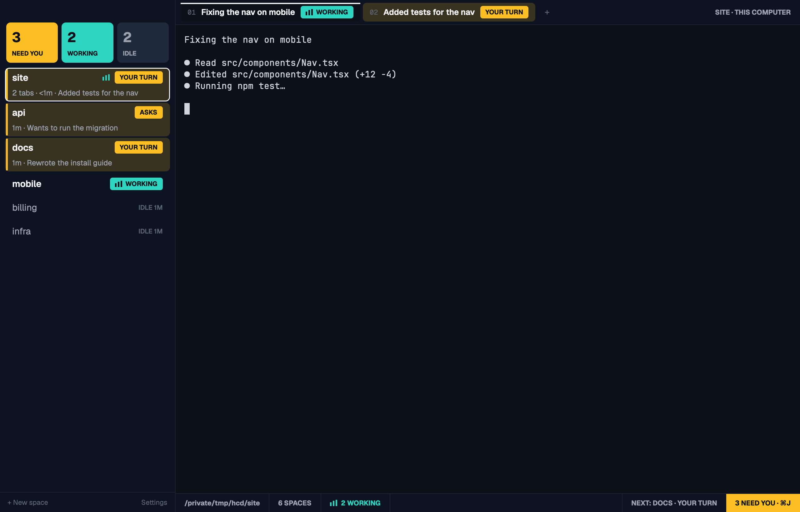

# Signal

A loud, labelled Herdr window. The left side is one list of your spaces, grouped by machine, in Herdr's own order, and every row says its status in a filled block. Three counters above the list say how many agents need you, how many are working and how many are idle. A numbered tab bar shows each tab of the current space with its status, and a status bar says where you are and who is next. Two colors, each with one job: amber is waiting on you, teal is working.

It is the bold sibling of [Index](../index/RECIPE.md): the same rules for who waits on you, drawn so you can read them from across the room.

## What you see

The window has no system title bar. It is one row: the sidebar (280 px, min 44, max 480), a 1 px `#1c2433` line, then the work area. macOS draws its traffic lights at `[14, 10]` over the sidebar's top.

**Sidebar** (`#0d1320`), top to bottom:

1. **Top strip, 32 px.** Empty. You drag the window by it.
2. **Counters.** Three equal blocks, 6 px apart, radius 7. Each is a number (22 px bold) over a label (10 px bold):
   - "NEED YOU": amber `#fbbf24`, text in the window color `#0b1019`. Clicking it does what ⌘J does. At 0 it turns the neutral `#1f2a3d` with gray text.
   - "WORKING": teal `#2dd4bf`, same dark text. Neutral at 0.
   - "IDLE": `#1f2a3d`, text `#9ca3af`.
3. **Machine sections**, in Herdr's order. The label is the machine's name in capitals (11 px bold, `#9ca3af`), then the number of spaces in it (`#5b6475`), then a hairline to the edge. An unreachable machine reads "NAME · OFFLINE" and its rows are dimmed to 50%. With only one machine there are no labels.
4. **Space rows**, 36 px tall (54 px with a detail line), radius 7, 2 px apart:
   - the name on the left, 14.5 px semibold; a status block on the right;
   - **status block**, 20 px tall, radius 4, 10.5 px bold capitals: "ASKS" or "YOUR TURN" on amber; three moving bars and "WORKING" on teal; "IDLE 5H" (the age) with no fill in `#5b6475`. A space with no agent has no block;
   - a **waiting row** (asks or your turn) is filled with amber at 18% (10% on light), has a 3 px amber bar down its left edge, and a detail line (12 px, `#9ca3af`, truncated): "<age> · <title>". For the current space with two or more tabs it starts "2 tabs · ";
   - when the block is amber and another agent in that space is still working, the three teal bars (no word) sit just left of the block;
   - a space with two or more agents says "2 agents" (11 px, `#5b6475`) before the block, when the row isn't waiting;
   - the **current space** has a 1.5 px outline in `#f3f4f6` and no fill of its own;
   - idle rows have their name in `#9ca3af`, weight 500. Rows that aren't waiting get `#121a29` on hover.
5. **Sub-agents that ask** (terminals an agent started with `hc run`, while blocked) appear as an indented waiting row under their space. Then the space row shows the "ASKS" block but isn't filled, so nothing is filled twice.
6. **Footer, 32 px**, with a hairline above: "+ New space" and "Settings", 11 px, `#5b6475`.

**Tab bar, 40 px** (`#0d1320`, hairline below, you can drag the window by it):

- one tab per tab of the current space, 30 px tall, radius 6, 4 px apart: a two-digit number ("01", Geist Mono 11 px, `#5b6475`), the name (13 px, truncated at 220 px), then the status block (none for an idle tab). The name is the one you gave the tab, else its agent's title, else its program ("zsh");
- the shown tab is `#0b1019` with a 2 px `#f3f4f6` line across its top, semibold;
- a waiting tab that isn't shown is filled amber at 18%, semibold;
- other tabs are `#1f2a3d` with `#9ca3af` text;
- a "+" after the last tab opens a new tab;
- on the right, "SPACE · MACHINE" in capitals (11 px bold, `#9ca3af`), e.g. "SITE · THIS COMPUTER".

**The shown tab** fills the middle. A single pane is a bare terminal. Split panes are separated by 1 px lines and each gets a 26 px label: the program name, its status block, then its folder.

**Status bar, 30 px** (`#0d1320`, hairline above, 11 px bold, `#9ca3af`, cells separated by hairlines):

- the focused terminal's folder and git branch, in their own case;
- "6 SPACES";
- the moving bars and "2 WORKING" in teal (left out at 0);
- at the right, "NEXT: API ASKS" or "NEXT: DOCS · YOUR TURN": the agent ⌘J would go to (left out when nothing waits or it already has focus);
- an amber block, dark text: "3 NEED YOU · ⌘J" (left out at 0). Clicking it or the "next" cell does what ⌘J does.

Files and Changes live in a hidden 368 px panel on the right, shown by key.

**Colors** (themes `signal-dark` and `signal-light`; the layout follows Herdr's appearance setting). Everything not listed is Index's Slate.

| Role | Dark | Light |
|---|---|---|
| Waiting on you (`accent`, `blocked`, `done`) | `#fbbf24` | `#b45309` |
| Working (`working`) | `#2dd4bf` | `#0f766e` |
| Text on either (`accent_foreground`) | `#0b1019` | `#ffffff` |
| Neutral block (`raised`, `selected`) | `#1f2a3d` | `#e5e7eb` |

The UI font is Geist. Herdr ships it in one weight, so the mod brings Geist SemiBold and Bold in `mods/signal/fonts/` (SIL Open Font License). The terminal font is whatever your settings say.

## How it behaves

**Agent statuses:**

| Status | Comes from | Block | Row or tab |
|---|---|---|---|
| asks | Herdr's `blocked`, or a sub-agent that's blocked or errored | "ASKS", amber | filled amber |
| your turn | the agent went from working to done or idle, and hasn't worked or been dismissed since | "YOUR TURN", amber | filled amber |
| working | Herdr's `working` | bars + "WORKING", teal | plain |
| idle | anything else | "IDLE <age>", no fill | gray name |

- The rules for what waits on you are Index's, unchanged: what ends "your turn" (a reply, ⇧⌘J, the agent going away; not looking at it), first sight, sub-agents, and ⌘J's order (asks first, each followed by its asking sub-agents, then your-turn ones, in list order, wrapping). See [Index's recipe](../index/RECIPE.md).
- **Signal and Index share one record** of who waits on you (`shared("index.turns")`). Switch between them and the same agents are waiting.
- A space row shows its most urgent agent: asks, then your turn, then working.
- **"NEED YOU"** is the number of agents ⌘J would visit, asking sub-agents included. "WORKING" and "IDLE" count each space's own agents that don't wait. So the three add up to the agents listed, plus one for each sub-agent that asks.
- Rows never move on their own. Drag a space row to reorder it within its machine. Double-click a space or tab to rename it; right-click for Herdr's menu. Drag a tab onto another to move it there.
- Clicking a space row selects it; a tab, shows it; a sub-agent row, focuses it (or opens it in a peek when it has no pane).

**Keys** (in a `layout:signal` section, so only while Signal shows):

| Key | Command | What it does |
|---|---|---|
| ⌘J | `signal.next-needs-you` | Jump to the next agent that needs you |
| ⇧⌘J | `signal.dismiss` | Clear "your turn" on the focused agent |
| ⇧⌘E | `signal.files` | Show or hide Files |
| ⇧⌘G | `signal.changes` | Show or hide Changes |

**Narrow sidebar** (under 160 px): a rail. The need-you count in amber, then one cell per space with a hairline between machines: an amber dot waits, a pulsing teal dot works, a small gray dot is idle. A waiting cell is filled amber; the current one is outlined.

**Hidden sidebar:** the tab bar moves its tabs right to clear the traffic lights, and the keys still work.

## Built from

- `layouts/signal.json`: root `row`, `titlebar: none`, `ui_font: Geist`, themes by appearance.
  - `sidebar` column (280 px): `sidebar-top` (32 px, `role: top`), `sidebar-list` (`role: sidebar`).
  - `work` column: `tabs` (40 px, window drag, `role: tabs`); `work-body` row with `main` (`tab: active`, pane frames with `gap: 1`, `radius: 0`, `lone: false`, a 26 px `signal` header) and the hidden `panel` column holding a `panel-body` stack of the shipped `files` and `changes` mods; `status` (30 px, `role: bar`).
- `mods/signal/`: one mod, five roles chosen by `props().role` (a pane header gets `props().pane`).
  - `main.js` picks the role.
  - `model.js` and `turns.js` are byte-for-byte the files in `index/mods/index/`. `buildGroups({ flat: true })` gives the sidebar its rows; the tab bar calls it without `flat` and takes the current space's `tabs`. `tally()` gives the counters. `keyLabel(…, "layout:signal")` reads the key hint.
  - `sidebar.js` (counters, list, rail), `tabs.js`, `bar.js` (status bar; owns the key commands through `nextCommand()`), `pane.js`, `ui.js` (the status block and the bars), `colors.js` (the amber wash).
  - `fonts/`: Geist SemiBold and Bold.
- `herdr` functions: `spaces`, `agents`, `terminals`, `machines`, `panes`, `focused`, `layout`, `window`, `settings`, `keys`, `theme`, `home`, `props`, `shared`, `setShared`, `setAgentOrder`, `nextCommand`, `openOverlay`, `run`.
- Commands it runs: `space.select`, `space.move`, `space.rename`, `space.new`, `tab.select`, `tab.move`, `tab.rename`, `tab.new`, `agent.focus`, `terminal.peek`, `layout.show`, `layout.hide`, `layout.select`, `app.settings`.
- The bars are three 2.5 px divs with `.loop("height", { from: 3.5, to: 10, period })` at 900, 1150 and 1400 ms.
- Adapted from Herdr's shipped mods (Apache-2.0): drag-to-reorder from `spaces`; tab clicks, the tab menu and the traffic-light padding from `tabs`.

## Watch out

- **Herdr refuses imports from outside a mod's folder.** That's why Signal carries copies of Index's `model.js` and `turns.js`. `tests/signal.test.js` fails when they differ: change both, or neither.
- **Herdr's Geist has one weight.** `font_bold()` and `font_semibold()` do nothing with it. The bundled faces fix that, but Herdr loads a mod's fonts at start: after installing, restart Herdr once or the text stays thin. Once loaded, they apply to every layout that uses Geist, so Index's semibold text gets heavier too.
- **`<mod>.<command>` keys reach only copies on screen.** The status bar owns them because it is always shown. Only one role may await `nextCommand()`.
- **`flex_shrink()` takes a number.** Called bare, the copy fails to draw ("This view could not be re-rendered"). Use `flex_shrink_1()`.
- **`loop()` has no delay**, so the three bars get different periods to move out of step.
- **gpui-kit has no letter-spacing**, so the capitals aren't tracked.
- **Unknown theme color names may not reach `theme()`.** The themes use known names only; the wash is worked out in `colors.js`.
- **Amber on white is unreadable.** The light theme uses `#b45309` with white text.
- **Herdr's gallery install copies only `layouts/` and `mods/`**, not `themes/`. Use `./install.sh signal`.
- **A key bound in your `terminal` section wins** over the `layout:signal` ones. The installer says so and skips it.
- **Ages start at `<1m`** on a fresh install, and agents that are idle then start idle, not "your turn": Signal can't know whether they're waiting on you.
- **To shoot a preview without your real spaces,** follow the steps in Index's recipe with `signal` in place of `index`. Keep the demo home's path short (`/tmp/<name>`): Herdr's socket lives in it and long paths fail. Restart the demo window after installing so the fonts load.

## Done when

- `npm test` passes: the copies of `model.js` and `turns.js` match Index's; `flat` rows light the current space and carry agent count, tab count, age and the "also working" cue; "NEED YOU" equals the ⌘J count; each theme uses amber only for waiting and teal only for working.
- `herdr-app check mods/signal` passes, and after `layout.switch {"name":"signal"}`, `herdr-app status` shows no errors.
- With one agent that asks, two that finished, two working and two idle:
  - the counters read 3 / 2 / 2 and the status bar's block reads "3 NEED YOU";
  - the asking row and tab say "ASKS" on amber; a finished one says "YOUR TURN" until you reply or press ⇧⌘J; a working one has moving bars on teal; an idle one reads "IDLE <age>" in gray;
  - a space with one agent waiting and one working shows the amber block with teal bars beside it;
  - the tab bar lists the current space's tabs, numbered; clicking one shows it; "+" adds one;
  - `signal.next-needs-you` moves to the asking agent first; `signal.dismiss` on a finished one drops the count by one; `signal.files` shows and hides the panel.
- With `appearance` set to `light`, the light theme shows and both blocks are readable.
- Text set bold is visibly bold after a restart.
- Switching to Index and back shows the same agents waiting.
